# Contributing to Cost Deck

Issues and pull requests are welcome. For a security problem, follow the
[security policy](SECURITY.md) instead of opening an issue.

## Build and test

```bash
make test        # unit and envtest tests
make lint        # golangci-lint
make ui-lint     # TypeScript and ESLint
make ui-test     # dashboard unit and component tests (Vitest)
make ui build    # dashboard + manager binary with the dashboard embedded
make test-e2e    # Kind cluster + Helm install + the regression scenarios in hack/e2e
```

After editing `api/v1/*_types.go` or a `+kubebuilder` marker, run
`make manifests generate` and commit the generated files with your change: CI fails when
they differ.

## End-to-end suite

The end-to-end suite runs in CI on every pull request. Every scenario in `hack/e2e` covers
behaviour users depend on, against real pods and real dependencies: scheduling,
dependencies, stage timeouts, workload rules, holiday exceptions, namespace selectors,
preview and dry run, GitOps pausing, operator-run services, realized savings, GPUs, AI
costs, auth with Keycloak, the API, VictoriaMetrics history, MCP, the sleep page, sleep
when unused, Slack, Teams and email, Argo Rollouts, preview cleanup, cost allocation,
several clusters, cost estimates, Java heap advice from JVM flags and metrics, performance
risks from real OOM kills, crash loops and autoscalers, timed wake-ups and prewarm, and
right-sizing applied, guarded and proposed in a real Gitea. A change that breaks one fails
the build, and a feature or fix that changes behaviour adds or extends a scenario.

To run it against an existing test cluster instead of a new Kind cluster:

```bash
SKIP_INSTALL=1 ./hack/e2e-smoke.sh                 # skips the settings-changing scenarios
SKIP_INSTALL=1 DISPOSABLE=1 E2E_ONLY='30|40' ./hack/e2e-smoke.sh
SKIP_INSTALL=1 DISPOSABLE=1 E2E_PART=2/3 ./hack/e2e-smoke.sh   # one of the three parts CI runs
```

Never use `DISPOSABLE=1` against a shared cluster: some scenarios change Cost Deck's
settings.

Pull requests run the suite in three parts at once, each in its own Kind cluster on
Kubernetes 1.35; `hack/e2e/durations.txt` keeps the parts the same length, and a new
scenario joins one by itself. Every night the whole suite runs in order on Kubernetes 1.31
and 1.37. The pull request check to require is **CI result**, which fails when any job of
the run fails: Go, UI, Helm, the install bundle, known vulnerabilities, dependency review,
conventional commit messages, zizmor on the workflows, shellcheck, the image scan and the
end-to-end parts.

## Fuzzing

Schedule windows, the next schedule change, holiday exceptions, cost estimates and the
reading of JVM flags have Go fuzz tests. `go test` runs their seed inputs, and every night
each one is fuzzed for ten minutes; a failing input is kept as a workflow artifact, to be
copied into `testdata/fuzz` as a regression test. To fuzz one locally:

```bash
go test ./internal/scaling -run '^$' -fuzz '^FuzzScheduleWindow$' -fuzztime 1m
```

## Commits

One conventional commit per feature or fix (`feat(scope):`, `fix(scope):`, `docs:`,
`ci:` and so on): release-please builds the release notes from them, and CI rejects other
messages.

## How it fits together

```mermaid
graph TD
    subgraph Clients
        UI[Dashboard]
        AI[AI clients via MCP]
        CHAT[Slack, Teams, email, Webex]
        CI[CI: cost estimate]
        PR[Prometheus]
    end

    subgraph Operator["Cost Deck operator (one binary)"]
        API[REST API, sign-in, MCP, sleep page]
        CTRL[Controllers: schedules, dependencies, discovery, usage, idle]
        FIN[FinOps: cost ledger, budgets, allocation, digests, bill reconciliation]
        OPT[Right-sizing guard, performance risks, preview cleanup]
        NOTIFY[Notifications, Webex bot]
        MET[metrics endpoint]
    end

    subgraph Cluster["Kubernetes"]
        CRD[CRDs: ScalingGroup, ScalingConfig, RightsizingPolicy, NamespaceFinOps, NamespaceOptimization, CostDeckConfig]
        WL[Deployments, StatefulSets, Argo Rollouts, CronJobs, KEDA, operator-run databases]
        GW[Gateway API routes]
        INF[Nodes, volumes, load balancers]
        MS[metrics-server]
    end

    subgraph External
        VM[VictoriaMetrics]
        CLOUD[AWS, Azure, Google Cloud: resources, prices, bill]
        GIT[GitHub, GitLab, Gitea]
        LLM[AI provider]
        SSO[Entra ID, Keycloak, OpenID Connect]
        OTHER[Other Cost Deck clusters]
    end

    UI --> API
    AI --> API
    CI --> API
    CHAT <--> NOTIFY
    PR --> MET
    API --> CRD
    API --> OTHER
    CTRL --> CRD
    CTRL --> WL
    CTRL --> GW
    CTRL --> MS
    CTRL --> VM
    CTRL --> CLOUD
    CTRL --> NOTIFY
    FIN --> INF
    FIN --> CLOUD
    FIN --> NOTIFY
    OPT --> WL
    API --> GIT
    OPT --> NOTIFY
    API --> LLM
    API --> SSO
```


