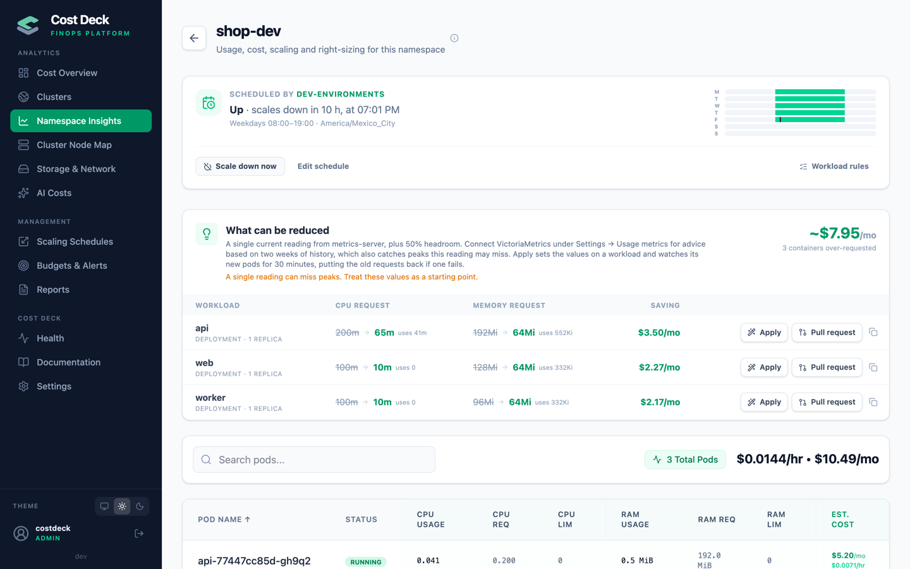
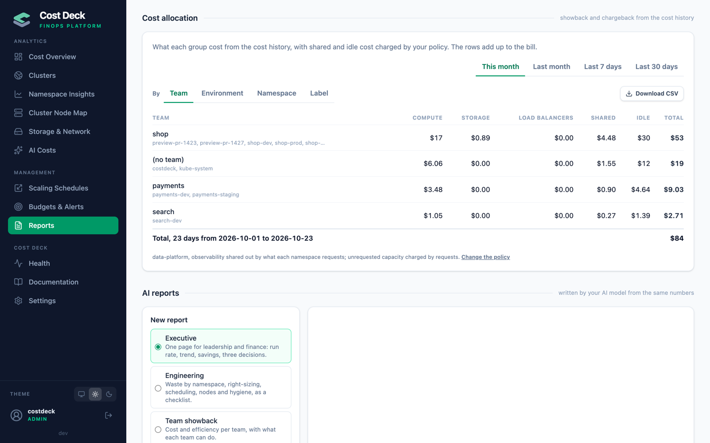
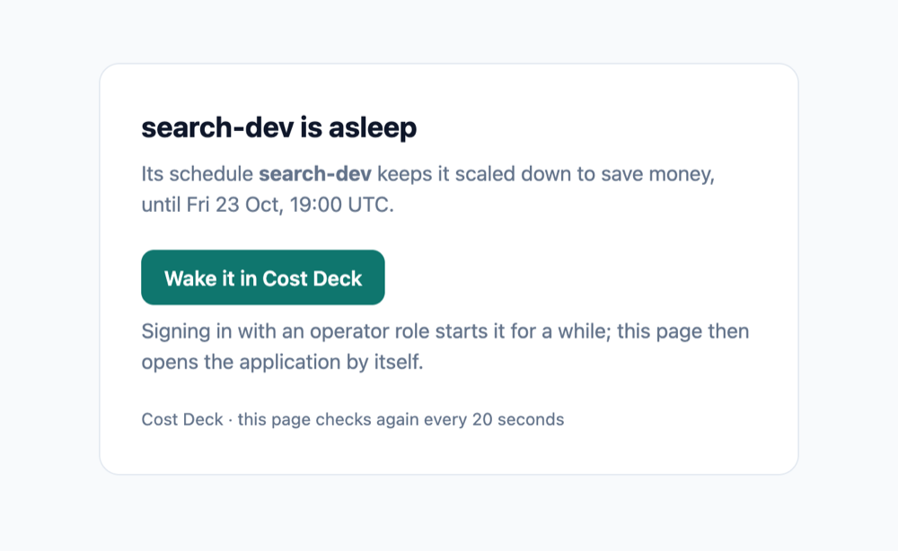
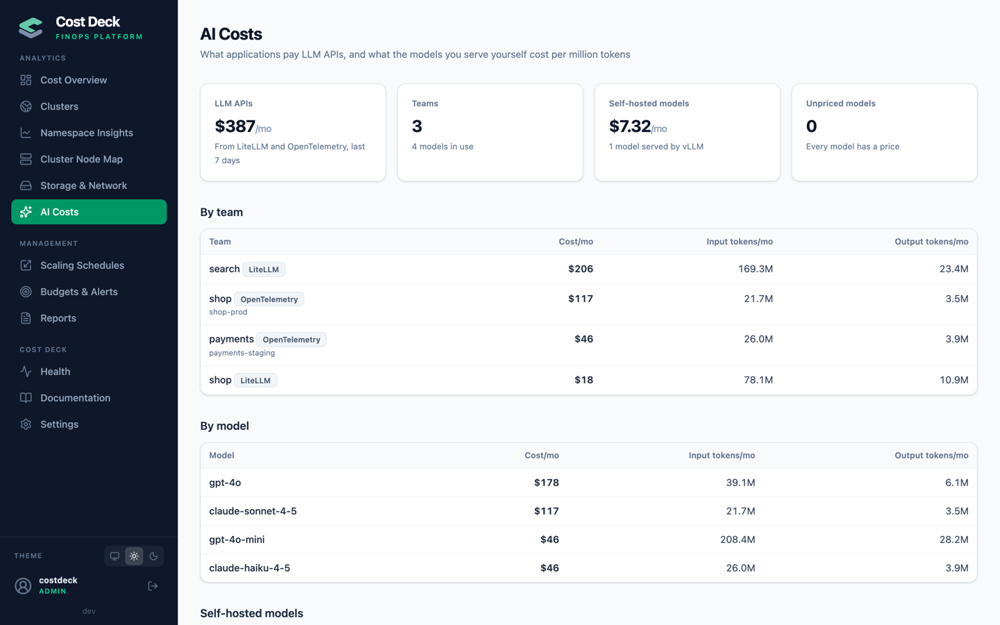
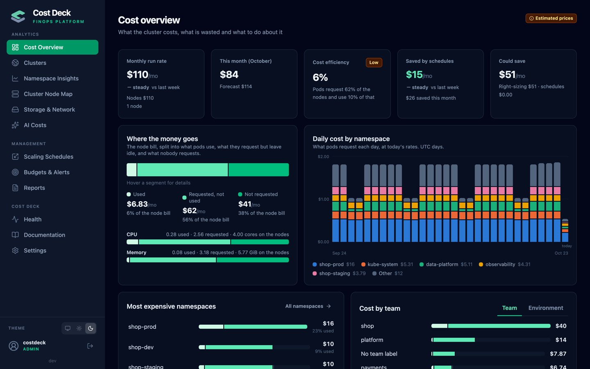

<p align="center">
  
</p>

<p align="center">
  <strong>Kubernetes FinOps operator: see what every namespace costs, and stop paying for idle infrastructure.</strong>
</p>

<p align="center">
  <a href="https://github.com/migalsp/costdeck/actions/workflows/ci.yml"></a>
  <a href="https://github.com/migalsp/costdeck/releases"></a>
  <a href="https://opensource.org/licenses/Apache-2.0"></a>
</p>

<br />

Cost Deck runs in your cluster. It shows what the cluster, each namespace and each team
cost and waste, including what applications pay LLM APIs and what GPUs and self-hosted
models cost, sets budgets that warn you before the month runs over, and scales
non-production environments to zero when nobody needs them, then brings them back on
time. It advises on requests and node shapes and, if you allow it, applies the advice
with a guard that puts it back, or opens a pull request with it. There is no external
service: one operator in your cluster does it all.


<table>
  <tr>
    <td width="33%" valign="top"><br><sub><b>Namespace Insights</b>: cost, usage, trend and what could be saved, per namespace</sub></td>
    <td width="33%" valign="top"><br><sub><b>Scaling Schedules</b>: working hours, platforms on demand, holidays and exceptions</sub></td>
    <td width="33%" valign="top"><br><sub><b>Budgets &amp; Alerts</b>: monthly limits, forecasts and alerts sent to Slack and Teams</sub></td>
  </tr>
  <tr>
    <td width="33%" valign="top"><br><sub><b>Right-sizing</b>: what each workload could request, applied with a guard or as a pull request</sub></td>
    <td width="33%" valign="top"><br><sub><b>Cost allocation</b>: a period's cost by team with shared and idle cost, as CSV</sub></td>
    <td width="33%" valign="top"><br><sub><b>Sleep page</b>: what people see on a scaled-down environment, with a way to wake it</sub></td>
  </tr>
</table>

## Features

### See the cost

- **Cost overview.** The node bill split into what pods use, what they request but leave
  idle, and what nobody requests; the month to date with a forecast; week-over-week
  changes; cost by team and environment; and the savings opportunities, ranked.
- **Namespace Insights.** Every namespace with its cost, usage, efficiency, trend and
  findings, filtered by environment, team, schedule or finding, and exported as CSV.
- **Storage, network and the real bill.** Persistent volumes and load balancers are priced
  and charged to their namespace, and unused volumes and idle load balancers are found.
  Costs can be reconciled with the AWS, Azure or Google Cloud bill, so discounts,
  reservations, savings plans and spot prices show in every figure.
- **Prices you can check.** AWS and Azure list prices per instance type, your own rates,
  or an estimate in line with cloud list prices. Every figure says which basis it uses.
- **Several clusters.** One installation shows the others side by side, read with a viewer
  API token each: cost, savings, this month so far and totals.

### AI and GPU costs

<p align="center"></p>

- **LLM API spend by team and model.** What applications pay OpenAI, Anthropic, Google
  and others, read from LiteLLM's spend or from OpenTelemetry GenAI token counts
  (`gen_ai.client.token.usage`) priced at your model prices, with every model that has no
  price yet called out.
- **Self-hosted models.** What a model you serve with vLLM costs per million tokens: its
  namespace's run rate, GPUs included, divided by the tokens it serves.
- **GPUs.** GPUs are priced apart from CPU and memory (their share of the node's list price,
  or an estimate per model) and charged to the namespaces that request them. With NVIDIA's
  DCGM exporter in VictoriaMetrics, Cost Deck finds idle GPUs, GPUs workloads could share
  through MIG or time-slicing, and cheaper models with enough memory, and a namespace
  whose GPUs sit idle can go to sleep.
- **Asked from anywhere.** The assistant and MCP clients get the same numbers
  (`get_ai_costs`, `get_gpu_usage`), and the assistant's own tokens have a monthly budget.

### Scale non-production to zero

- **Scaling schedules.** Pick namespaces and when they should run: working hours, the work
  week non-stop, or any custom windows, in any time zone. Outside those hours workloads go
  to zero; their replica counts are restored afterwards.
- **Shared platforms on demand.** A schedule can depend on another one. An on-demand
  platform (databases, Kafka, logging) starts only while an environment that needs it is
  up, and environments wait until it is fully up.
- **Schedules suggested from usage.** One click reads a week of a namespace's CPU usage and
  fills in the hours it is busy, with the saving.
- **Overrides that end on their own.** "Start now" or "Scale down now" holds until the next
  scheduled change, or for a time you choose, then the schedule takes over again.
- **Holidays and release weekends.** Dated exceptions and shared holiday calendars keep a
  schedule down (or up) on given days without editing its hours.
- **Namespaces by label.** A schedule can take every namespace with a label, so preview
  environments join as they are created and leave when the label goes.
- **Preview and dry run.** See what a schedule would stop, when, and what it saves before
  saving it, or let it run in a dry run that decides but scales nothing.
- **Sleep when unused.** An environment nobody has sent a request to for an hour (Envoy
  Gateway, Istio or ingress-nginx metrics), or whose GPUs sat idle (DCGM), goes down
  inside its schedule's hours too.
- **A sleep page while down.** A sleeping environment's Gateway API routes show a page that
  says it is asleep and links to waking it for an hour or two, instead of a gateway error.
- **Everything that runs in a namespace.** Deployments, StatefulSets and Argo Rollouts
  (canary and blue-green, including those that take their pods from a Deployment); CronJobs
  are suspended and KEDA ScaledObjects paused while the namespace is down. CloudNativePG and
  Zalando Postgres clusters, Strimzi Kafka Connect, MirrorMaker 2 and Bridge, or any
  operator's resource with a replica field, stop after the namespace's workloads and start
  before them.
- **GitOps-aware.** Workloads managed by Argo CD or Flux are named in the preview, and a
  schedule can pause the tool while it keeps them down and resume it afterwards.
- **Cloud resources too.** Namespaces start stage by stage and stop in reverse, and the
  stages can include AWS Aurora and EC2, Azure VMs and PostgreSQL/MySQL flexible servers,
  and Google Cloud Compute Engine and Cloud SQL.
- **Savings that reach the bill.** After a scale-down, each schedule shows which nodes the
  autoscaler removed and what keeps the others: a PodDisruptionBudget, `do-not-disrupt`,
  `safe-to-evict: "false"`, local storage, or other namespaces still using them.

### Right-size and clean up

- **Right-sizing advice.** Which requests can shrink (p95 usage when VictoriaMetrics is
  connected), with the saving per workload. Cost Deck never touches nodes.
- **Applied with a guard, or as a pull request.** If you allow it, operators apply the
  advice from a namespace's page: the new pods are watched, and the old requests come back
  (with an alert) if one is OOMKilled, restarts or crash-loops. Workloads a GitOps tool
  manages get a pull request in your GitHub, GitLab or Gitea repository instead, with the
  manifest's comments kept. Every change is listed with who made it.
- **Node advice.** Per node pool, the instance type and count that fit the requests, arm64
  alternatives and spot capacity for non-production workloads.
- **Cost in pull requests.** A GitHub Action (or the image in any CI) comments on a pull
  request with what its manifests change will cost a month, at your cluster's rates and
  schedules, and can fail the check above a limit.
- **Preview cleanup.** Namespaces of preview environments are deleted some time after
  they were created, with a warning first, a dry run and a way to keep one longer. Off
  unless you turn it on, twice: in the chart and in the settings.

### Budgets and reports

- **Budgets and alerts.** Monthly budgets per cluster, team, environment or any set of
  namespaces, alerting at thresholds and when the month is heading over, and daily cost
  anomaly alerts.
- **Showback and chargeback.** A period's cost by team, environment, namespace or any label
  such as `cost-center`, with shared namespaces and idle capacity charged by your policy,
  adding up to the bill, as a table and a CSV for finance.
- **Digests and AI reports.** A weekly or monthly cost digest, and reports for leadership,
  engineers and teams written by your AI model from the same numbers.

### Fits your team

- **Access.** Local users with viewer, operator and admin roles, single sign-on with
  Microsoft Entra ID, Keycloak or any OpenID Connect provider with group-to-role mapping,
  API tokens, and least-privilege RBAC: Secrets are only read in the operator's own
  namespace. Applying right-sizing advice and deleting preview namespaces are off until
  an admin turns them on.
- **Where you already work.** Alerts, digests and scaling changes in Slack, Microsoft
  Teams, email and Webex, a Webex bot, an AI assistant (Claude, OpenAI-compatible or
  Gemini) that proposes actions for you to confirm, an MCP server for AI clients, and
  Prometheus metrics.
- **A dashboard to share.** Every page has its own address, a light and a dark theme, and
  every setting is in one place.

<p align="center"></p>

## Quick start

```bash
helm upgrade --install costdeck-operator \
  oci://ghcr.io/migalsp/costdeck/charts/costdeck-operator \
  --version <version> --namespace costdeck --create-namespace

kubectl get secret costdeck-operator-admin-credentials -n costdeck \
  -o jsonpath='{.data.password}' | base64 -d; echo
kubectl port-forward -n costdeck svc/costdeck-operator-api 8082:8082
```

Open http://localhost:8082 and sign in as `costdeck`. Pick the latest version from
the [releases](https://github.com/migalsp/costdeck/releases). The
[installation guide](docs/installation.md) covers Ingress, SSO, cloud accounts, monitoring
and every chart value.

## Documentation

- **In the dashboard**: the **Documentation** page has step-by-step guides (schedules,
  cloud resources, cost and savings, nodes, storage and network, budgets, reports, access
  and sign-in, the AI assistant, MCP clients, Slack, Teams and email, Webex, monitoring
  Cost Deck, troubleshooting) and a REST API reference generated from the live OpenAPI
  document.
- **[Installation guide](docs/installation.md)**: chart values, Ingress, single sign-on,
  cloud permissions, monitoring, upgrades.
- **API**: Swagger UI at `/api/docs`, the specification at `/api/openapi.yaml` and
  `/api/openapi.json`. Every operation names the role it needs.

## How it fits together

```mermaid
graph TD
    subgraph Clients
        UI[Dashboard]
        AI[AI clients via MCP]
        CHAT[Slack, Teams, email, Webex]
        CI[CI: cost estimate]
        PR[Prometheus]
    end

    subgraph Operator["Cost Deck operator (one binary)"]
        API[REST API, sign-in, MCP, sleep page]
        CTRL[Controllers: schedules, dependencies, discovery, usage, idle]
        FIN[FinOps: cost ledger, budgets, allocation, digests, bill reconciliation]
        OPT[Right-sizing guard, preview cleanup]
        NOTIFY[Notifications, Webex bot]
        MET[metrics endpoint]
    end

    subgraph Cluster["Kubernetes"]
        CRD[CRDs: ScalingGroup, ScalingConfig, NamespaceFinOps, CostDeckConfig]
        WL[Deployments, StatefulSets, Argo Rollouts, CronJobs, KEDA, operator-run databases]
        GW[Gateway API routes]
        INF[Nodes, volumes, load balancers]
        MS[metrics-server]
    end

    subgraph External
        VM[VictoriaMetrics]
        CLOUD[AWS, Azure, Google Cloud: resources, prices, bill]
        GIT[GitHub, GitLab, Gitea]
        LLM[AI provider]
        SSO[Entra ID, Keycloak, OpenID Connect]
        OTHER[Other Cost Deck clusters]
    end

    UI --> API
    AI --> API
    CI --> API
    CHAT <--> NOTIFY
    PR --> MET
    API --> CRD
    API --> OTHER
    CTRL --> CRD
    CTRL --> WL
    CTRL --> GW
    CTRL --> MS
    CTRL --> VM
    CTRL --> CLOUD
    CTRL --> NOTIFY
    FIN --> INF
    FIN --> CLOUD
    FIN --> NOTIFY
    OPT --> WL
    API --> GIT
    OPT --> NOTIFY
    API --> LLM
    API --> SSO
```



## Development

```bash
make test        # unit and envtest tests
make lint        # golangci-lint
make ui-lint     # TypeScript and ESLint
make ui-test     # dashboard unit and component tests (Vitest)
make ui build    # dashboard + manager binary with the dashboard embedded
make test-e2e    # Kind cluster + Helm install + the regression scenarios in hack/e2e
```

The end-to-end suite runs in CI on every pull request. Every scenario in `hack/e2e`
covers behaviour users depend on, against real pods and real dependencies: scheduling,
dependencies, stage timeouts, workload rules, holiday exceptions, namespace selectors,
preview and dry run, GitOps pausing, operator-run services, realized savings, GPUs, AI
costs, auth with Keycloak, the API, VictoriaMetrics history, MCP, the sleep page, sleep
when unused, Slack, Teams and email, Argo Rollouts, preview cleanup, cost allocation,
several clusters, cost estimates, and right-sizing applied, guarded and proposed in a
real Gitea. A change that breaks one fails the build. A feature or fix that changes
behaviour adds or extends a scenario. To run it against an existing test cluster instead
of a new Kind cluster:

```bash
SKIP_INSTALL=1 ./hack/e2e-smoke.sh                 # skips the settings-changing scenarios
SKIP_INSTALL=1 DISPOSABLE=1 E2E_ONLY='30|40' ./hack/e2e-smoke.sh
SKIP_INSTALL=1 DISPOSABLE=1 E2E_PART=2/3 ./hack/e2e-smoke.sh   # one of the three parts CI runs
```

Pull requests run the suite in three parts at once, each in its own Kind cluster on
Kubernetes 1.35; `hack/e2e/durations.txt` keeps the parts the same length, and a new
scenario joins one by itself. Every night the whole suite runs in order on Kubernetes 1.31
and 1.37. The pull request check to require is **CI result**, which fails when any job of
the run fails: Go, UI, Helm, the install bundle, known vulnerabilities, dependency review,
conventional commit messages, zizmor on the workflows, shellcheck, the image scan and the
end-to-end parts.

Schedule windows, the next schedule change, holiday exceptions and cost estimates also
have Go fuzz tests. `go test` runs their seed inputs, and every night each one is fuzzed
for ten minutes; a failing input is kept as a workflow artifact, to be copied into
`testdata/fuzz` as a regression test. To fuzz one locally:

```bash
go test ./internal/scaling -run '^$' -fuzz '^FuzzScheduleWindow$' -fuzztime 1m
```

## License

[Apache 2.0](LICENSE)
