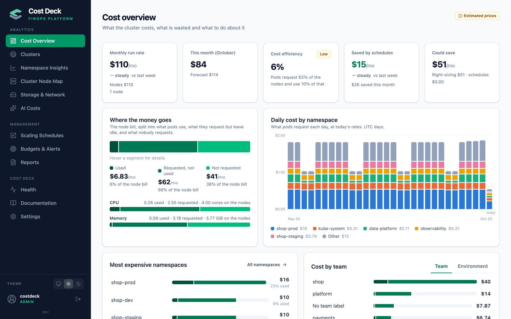
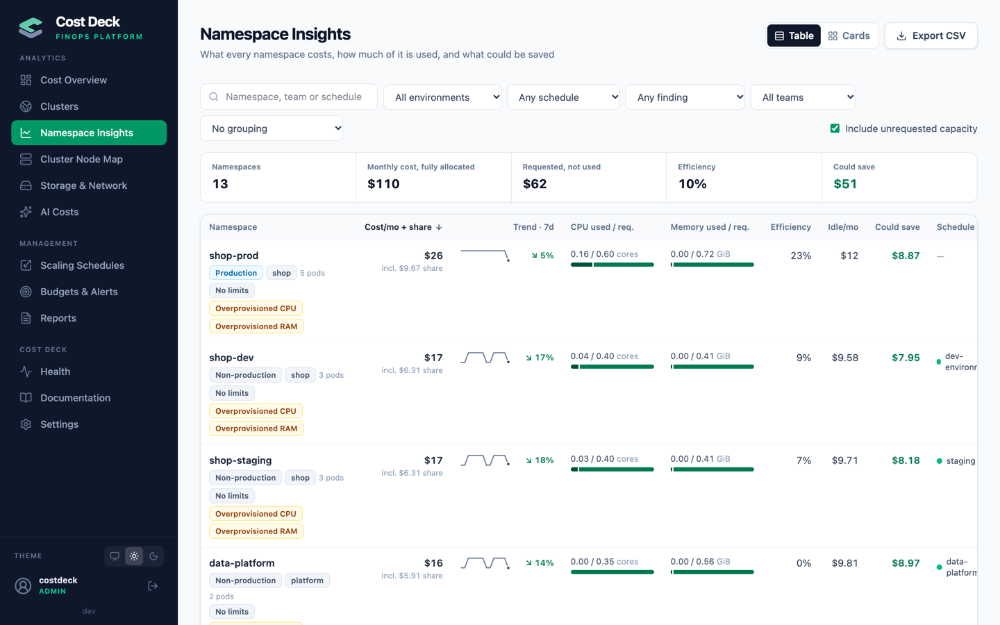
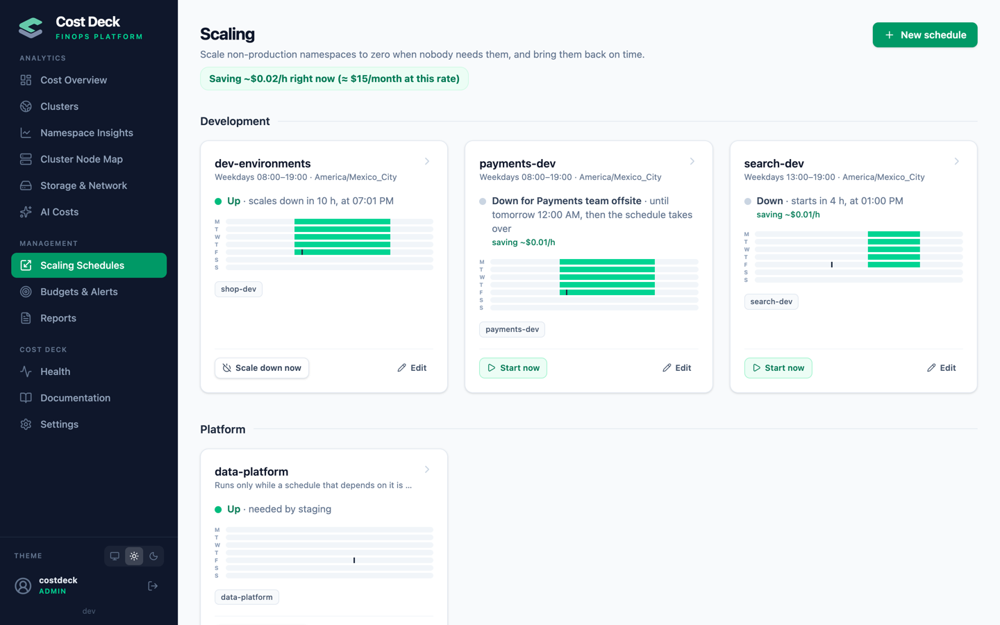
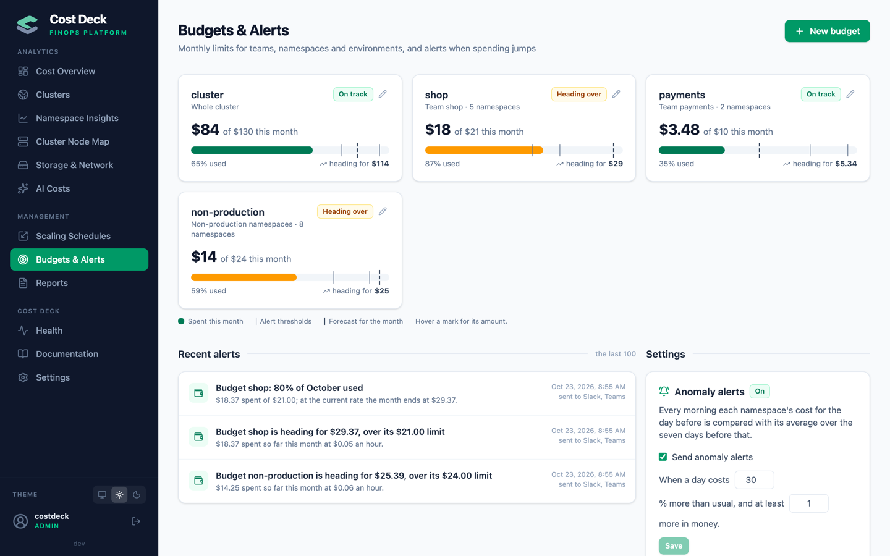
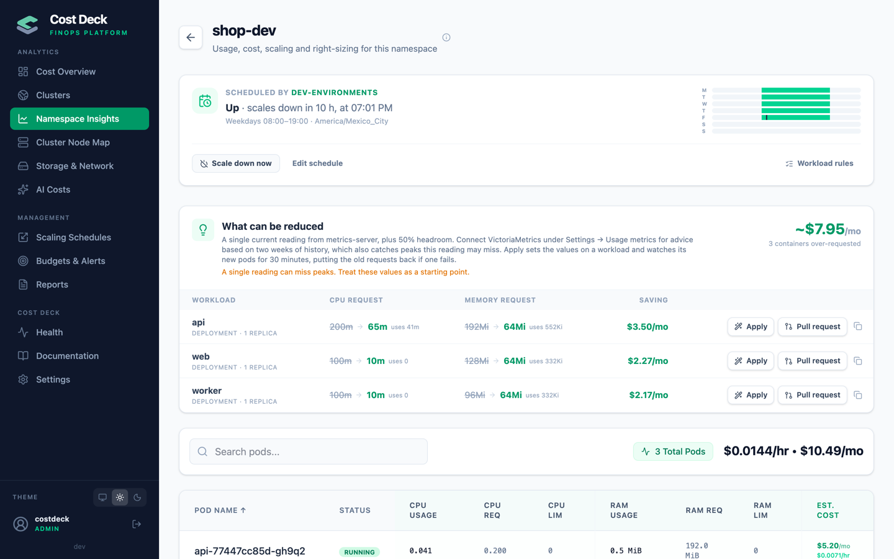
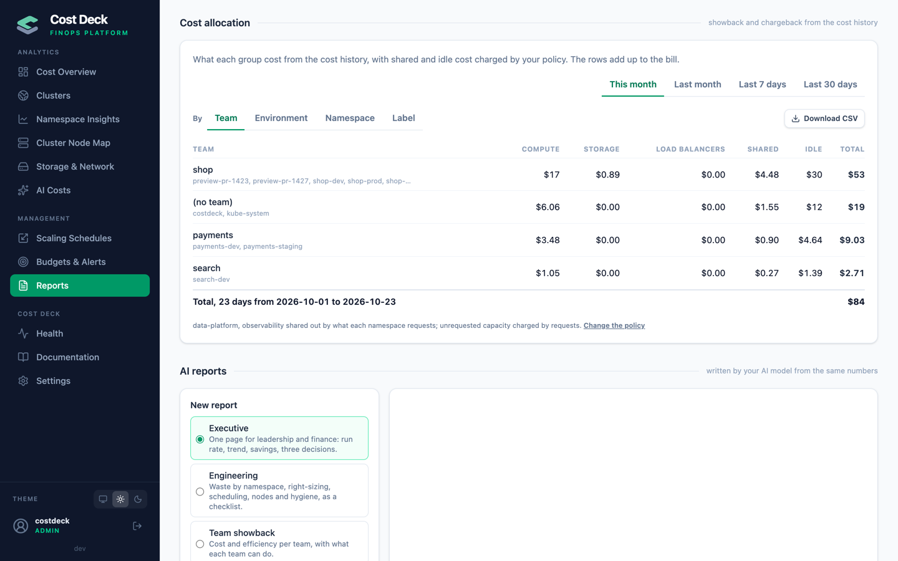
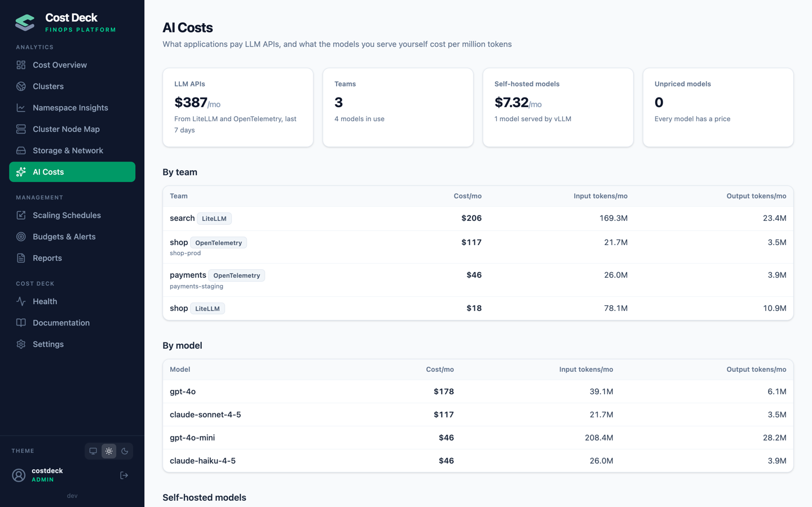

<p align="center">
  
</p>

<p align="center">
  <strong>Open-source Kubernetes FinOps operator: see what every namespace costs, cut the waste, keep performance safe.</strong>
</p>

<p align="center">
  <a href="https://github.com/migalsp/costdeck/actions/workflows/ci.yml"></a>
  <a href="https://github.com/migalsp/costdeck/releases"></a>
  <a href="https://scorecard.dev/viewer/?uri=github.com/migalsp/costdeck"></a>
  <a href="LICENSE"></a>
</p>

<p align="center">
  <a href="https://migalsp.github.io/costdeck/">Website</a> ·
  <a href="docs/installation.md">Installation guide</a> ·
  <a href="docs/roadmap.md">Roadmap</a> ·
  <a href="CHANGELOG.md">Changelog</a>
</p>

Cost Deck is an open-source (Apache 2.0) Kubernetes FinOps operator for platform teams and
the people who pay the cloud bill. It shows what every namespace, team and environment
costs, scales idle environments to zero, finds what is oversized, and checks that the
savings do not hurt performance. One operator runs in your cluster, with no external
service and no paid tier.

```bash
helm upgrade --install costdeck-operator \
  oci://ghcr.io/migalsp/costdeck/charts/costdeck-operator \
  --namespace costdeck --create-namespace
```

Needs Kubernetes 1.26+, Helm 3.8+ and metrics-server. [Quick start](#quick-start) has the
sign-in steps.

## Why

| The problem | What Cost Deck does |
|---|---|
| Clusters pay for capacity nobody uses, and the bill does not say whose it is | Cost per namespace, team and environment, split into used, idle and unrequested, and reconciled with the AWS, Azure or Google Cloud bill |
| Pods reserve far more CPU and memory than they use | Right-sizing advice with the saving per workload, Java heaps included, applied with a guard that rolls back or sent as a pull request |
| Teams pad requests because cutting them risks throttling and OOM kills | Performance risks for every namespace, and advice that never cuts a resource under pressure |
| Dev and staging run 168 hours a week for about 50 hours of work | Schedules that scale environments, and the cloud databases behind them, to zero and wake them before the day starts |
| LLM tokens and GPU hours arrive on one invoice, with no team or model attached | LLM API spend by team and model, the cost per million tokens of models you serve, GPU cost and idle GPUs |
| When a cost jumps, finding the namespace or the deploy behind it takes days | Budgets with forecasts, daily anomaly alerts and digests in Slack, Teams, email or Webex |



<table>
  <tr>
    <td width="33%" valign="top"><br><sub><b>Namespace Insights</b>: cost, usage, trend and what could be saved, per namespace</sub></td>
    <td width="33%" valign="top"><br><sub><b>Scaling schedules</b>: working hours, platforms on demand, holidays and exceptions</sub></td>
    <td width="33%" valign="top"><br><sub><b>Budgets and alerts</b>: monthly limits, forecasts and alerts sent to Slack and Teams</sub></td>
  </tr>
  <tr>
    <td width="33%" valign="top"><br><sub><b>Right-sizing</b>: performance risks, what each workload could request and the Java heap it needs</sub></td>
    <td width="33%" valign="top"><br><sub><b>Cost allocation</b>: a period's cost by team with shared and idle cost, as CSV</sub></td>
    <td width="33%" valign="top"><br><sub><b>AI costs</b>: LLM API spend by team and model, and what self-hosted models cost</sub></td>
  </tr>
</table>

<sub>Screenshots from a demo cluster.</sub>

## What it does

### See the cost

- **Cost overview**: the node bill split into what pods use, what they request but leave
  idle and what nobody requests, the month to date with a forecast, and ranked savings.
- **Namespace Insights**: cost, usage, efficiency, trend and findings for every namespace,
  filtered by team, environment or schedule, and exported as CSV.
- **Storage and network**: volumes and load balancers priced and charged to their
  namespace; unused volumes and idle load balancers found.
- **The real bill**: list prices (AWS, Azure), your own rates or an estimate, and with bill
  reconciliation every compute figure follows what the cloud charged, discounts included.
- **AI and GPUs**: LLM API spend by team and model (LiteLLM, OpenTelemetry GenAI), the cost
  per million tokens of models you serve with vLLM, GPU cost and idle GPUs (DCGM).
- **Several clusters** side by side, read with a viewer token each.

### Cut the waste

- **Scaling schedules**: working hours, custom windows, any time zone; replica counts come
  back afterwards. Suggested from a week of usage, with holiday calendars, dated
  exceptions and overrides that end on their own.
- **Whole environments**: shared platforms start first and only while an environment needs
  them; stages start in order and stop in reverse, together with AWS Aurora and EC2, Azure
  VMs and flexible servers, and Google Cloud Compute Engine and Cloud SQL.
- **Everything in a namespace**: Deployments, StatefulSets, Argo Rollouts; CronJobs
  suspended and KEDA paused while down; CloudNativePG, Zalando Postgres and Strimzi
  stopped after the workloads and started before them.
- **Sleep when unused, ready on time**: environments with no requests (Envoy Gateway,
  Istio, ingress-nginx) go to sleep; a sleep page offers to wake them; prewarm starts them
  ahead of the schedule.
- **Right-sizing**: which requests can shrink and the saving, Java heaps sized from the JVM
  flags and heap metrics, `RightsizingPolicy` bounds per team, and node shapes, arm64 and
  spot per node pool.
- **Savings that reach the bill**: which nodes the autoscaler removed after a scale-down,
  and what keeps the others.
- **Preview cleanup**: preview namespaces deleted after their time to live, with a warning
  first (off by default).

### Keep performance safe

- **Performance risks**: CPU throttling, OOM kills, crash loops, evictions, memory near the
  limit, autoscalers at their maximum and full JVM heaps, each with the fix and its cost.
- **Advice that respects pressure**: a throttled container keeps its CPU, and one that was
  OOM-killed keeps its memory.
- **Changes with a way back**: applied advice is watched and put back if pods fail;
  GitOps-managed workloads get a pull request (GitHub, GitLab, Gitea) instead.
- **Try before it acts**: preview and dry run for schedules, cost estimates on pull
  requests, and no schedule means always on.

### Budgets and reports

- **Budgets** per cluster, team, environment or set of namespaces, with forecasts, anomaly
  alerts and alerts on new critical performance risks.
- **Showback and chargeback** by team, environment, namespace or label, with shared and
  idle cost charged by your policy, adding up to the bill.
- **Weekly or monthly digests**, and AI-written reports for leadership, engineers and teams.

### Works with your tools and agents

- **Dashboard** with light and dark themes, a REST API with OpenAPI, and Prometheus metrics.
- **MCP server** at `/mcp` for Claude Code, Claude Desktop, Cursor and other MCP clients,
  and an AI assistant in the dashboard (Claude, OpenAI-compatible, Gemini) that proposes
  actions for you to confirm.
- **Notifications** in Slack, Microsoft Teams, email and Webex, plus a Webex bot.
- **Access**: viewer, operator and admin roles, single sign-on with Entra ID, Keycloak or
  any OpenID Connect provider, API tokens, and Secrets read only in its own namespace.
- **GitOps**: Argo CD and Flux are detected, and can be paused while an environment sleeps.

## Quick start

```bash
helm upgrade --install costdeck-operator \
  oci://ghcr.io/migalsp/costdeck/charts/costdeck-operator \
  --namespace costdeck --create-namespace

kubectl get secret costdeck-operator-admin-credentials -n costdeck \
  -o jsonpath='{.data.password}' | base64 -d; echo
kubectl port-forward -n costdeck svc/costdeck-operator-api 8082:8082
```

Open http://localhost:8082 and sign in as `costdeck`. Add `--version` to pin a
[release](https://github.com/migalsp/costdeck/releases). Connect VictoriaMetrics (or any
Prometheus-compatible API) for history, throttling and advice over weeks instead of one
reading. The [installation guide](docs/installation.md) covers Ingress, single sign-on,
cloud accounts, monitoring and every chart value.

## FAQ

**Does any data leave my cluster?**
No. Cost Deck has no service of its own outside your cluster. It calls only what you
configure: cloud APIs for prices, bills and resources, your AI provider, and your
notification channels.

**What does it change in my cluster?**
Replica counts (the original is kept on the workload), CronJob suspension, KEDA pausing
and, if you turn them on, sleep-page routes and GitOps pausing. Applying right-sizing and
deleting preview namespaces are off until an admin allows them. It never touches nodes.

**What happens when I delete a schedule?**
While the operator runs, deleting a schedule brings back what it scaled down, starts the
cloud resources it stopped, and resumes what it paused before the schedule goes.

**Kubernetes 1.37 lets an HPA scale to zero. Do I still need this?**
The HPA scales one workload on external or object metrics, and nothing buffers HTTP
requests while no pods are ready. Cost Deck puts whole environments to sleep on a
schedule, with their dependencies and databases, and shows a sleep page meanwhile.

**How should I size memory for Java pods?**
The JVM takes a quarter of the container limit as its heap by default, and native memory
comes on top. Cost Deck reads each container's JVM flags, keeps memory advice above heap
plus native memory, and recommends a heap from what is left after garbage collection.

**Can AI assistants use it?**
Yes. Point an MCP client at `https://<your-costdeck>/mcp` with an API token from Settings.
A viewer token gives read-only tools; actions need an operator token.

**Which clouds does it work with?**
Any Kubernetes cluster. Prices and bill reconciliation for AWS, Azure and Google Cloud;
schedules for AWS Aurora and EC2, Azure VMs and PostgreSQL/MySQL flexible servers, and
Google Cloud Compute Engine and Cloud SQL.

**Is it free?**
Yes, Apache 2.0, with no paid tier. Images and the Helm chart are signed with cosign.

## Roadmap

Next on the [roadmap](docs/roadmap.md): right-sizing in place without restarts, node pools
that scale to zero with their environments, right-sizing that respects autoscalers, AI spend
in team totals and budgets, and approvals in Slack and Teams. Then right-sizing on
autopilot, GPU sharing advice, network cost and a FOCUS export. Open an issue to move an
item up.

## Documentation

- **In the dashboard**: step-by-step guides on the **Documentation** page, and a REST API
  reference generated from the live OpenAPI document (Swagger UI at `/api/docs`).
- **[Installation guide](docs/installation.md)**: chart values, Ingress, single sign-on,
  cloud permissions, monitoring, upgrades and uninstalling.
- **[Roadmap](docs/roadmap.md)**, **[changelog](CHANGELOG.md)** and **[security policy](SECURITY.md)**.

## Contributing

Issues and pull requests are welcome. [CONTRIBUTING.md](CONTRIBUTING.md) explains how to
build Cost Deck, run its tests and the end-to-end suite, and write commits that
release-please can read.

## License

[Apache 2.0](LICENSE)
